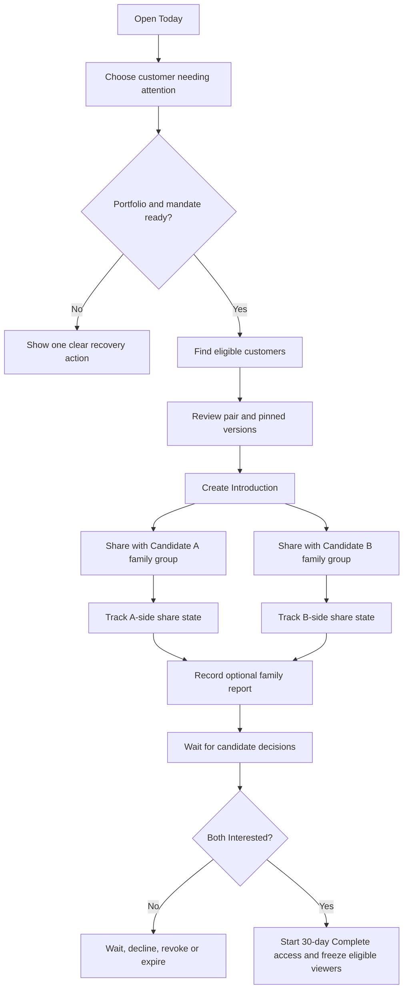
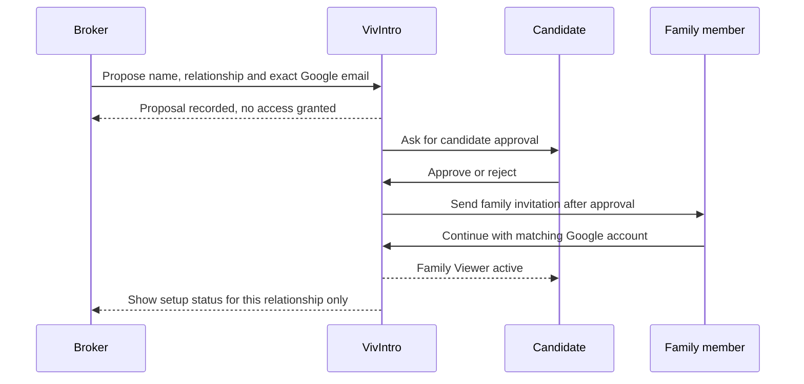

# NAK-208 VivIntroDesk UI system and clickable wireframes

Status: active design contract, 22 October 2026

Prototype: [`design/prototypes/nak-200-stage-b`](../prototypes/nak-200-stage-b/README.md)

The prototype directory retains its historical Stage B path so earlier review
links remain valid. Current work belongs to
`feat/nak-208-vivintrodesk-ui-wireframes`. NAK-200 is reserved for the V3
consent and RBAC foundation.

## Purpose

Define one coherent visual and interaction system for VivIntroDesk before
production pages are rebuilt. The wireframes test whether a small matrimonial
broker team can understand customers, create an Introduction, share it with
each family, record conversation context, and follow the two candidate
decisions without relying on Excel for state.

This work changes no production route, database object, authorization rule,
notification provider, or customer data. Every sample person and event is
fictional.

## Product authority

The approved family-assisted MVP contract remains product authority. This UI
must preserve these rules:

- an Introduction belongs to one broker workspace and two eligible canonical
  VivIntro customers;
- both candidate portfolios are published, current and pinned at creation;
- each broker workspace has independent lineage and cannot see another
  workspace's activity;
- one candidate-level Family Viewer roster covers all active broker mandates;
- a broker may propose a family member but cannot authorize that person;
- only the authenticated candidate may submit Interested or Decline;
- family reports are operational context, never candidate consent;
- any response controls inside this standalone prototype are visibly labelled
  candidate-session simulations and must not exist as broker runtime actions;
- A-side and B-side WhatsApp sharing are tracked independently;
- Broker Standard excludes Protected Contact, financial and restricted data;
- mutual interest starts one 30-day Complete access period;
- eligible Family Viewers are frozen when mutual interest begins; and
- the broker never sees Complete or Protected Contact through this workflow.

Horoscope and other preference differences remain advisory facts for human
review unless a later approved product contract defines a precise blocking
rule. The wireframe must not invent hard matching policy.

NAK-208 may illustrate planned NAK-201 through NAK-207 behavior, but it does not
make those backend capabilities implemented.

## Design read

VivIntroDesk should feel like a calm professional work surface for brokers who
know their customers personally and currently depend on WhatsApp and Excel. It
must be easier to scan than a generic CRM, warmer than enterprise administration
software, and more explicit than a consumer matchmaking application.

Design settings:

| Property | Value | Reason |
| --- | --- | --- |
| Design expression | 4/10 | Recognizable and polished without distracting from daily work |
| Motion | 2/10 | Feedback only; repeated navigation and list work stay immediate |
| Information density | 6/10 | Enough context for hundreds of relationships without spreadsheet overload |
| Theme | Light first | Familiar for office work; dark mode remains a later production-system requirement |
| Touch target | 48 px | Supports mobile use and less technical users |

## Reference policy

Astro themes are references for composition, not runtime dependencies or
component sources. VivIntroDesk stays inside the existing Next.js, React and
Tailwind application.

| Surface | Reference | Permitted influence |
| --- | --- | --- |
| Future public broker page | AstroWind | Marketing rhythm, responsive hierarchy and concrete calls to action |
| Broker onboarding | Astrodeck | Focused progression and clear continuation states |
| Workspace shell | Astronaut accessible dashboard | Navigation, landmarks, focus and narrow-screen behavior |
| Operational summaries | Florin | Compact grouping and readable metric rhythm, without finance styling |
| Customer and team lists | Flowbite Astro dashboard | Search, filter and row anatomy only |
| Help centre | Starlight | Future documentation structure only |
| Visual experimentation | Syntro | Inspiration only; no code copying |

No Astro runtime, Once UI, Flowbite package, DaisyUI, Bootstrap, Carbon,
Fluent, default shadcn theme, or second icon family is introduced. Selected
Radix primitives may provide accessible behavior underneath owned components.
Lucide remains the existing icon family.

## Owned component system

### Foundations

- semantic colour tokens for canvas, surface, structure, text and statuses;
- one 8 px spacing rhythm with a 4 px micro-spacing exception;
- 16 px panels, 8 px controls and full-radius status badges;
- Inter for dense body text and Plus Jakarta Sans for application headings;
- navy-tinted elevation, visible focus and reduced-motion behavior; and
- status meaning always expressed with text, never colour alone.

### Controls

- Button and IconButton
- Input, Select, Checkbox and Textarea
- Badge and Alert
- Dialog and Drawer
- Empty, Loading and Error states
- Search and Filter controls
- Responsive table or structured card list

### Workflow patterns

- WorkspaceShell and PageHeading
- ActionQueue
- CustomerCard and PortfolioReadiness
- FamilyViewerSummary
- MatchWorkspace and PairReview
- IntroductionActionWorkspace
- SideShareState
- FamilyUpdateSummary
- CandidateResponseState
- DisclosureNotice and ImmutableTimeline

Production components should live in the VivIntroDesk boundary and consume
server projections. They must not read raw portfolio, family, Introduction, or
cross-tenant rows in the browser.

## Information architecture

```text
Today
  Action queue

Customers
  Customer book
  Customer detail
    Readiness
    Broker Standard
    Family representatives
    Introduction history
    Find matches
      Candidate results
      Pair review
      Create Introduction

Introductions
  Introduction list
  Introduction action workspace
    Side A sharing
    Side B sharing
    Family reports
    Candidate decisions
    Disclosure clocks
    Immutable timeline

Team
Settings
```

There is no generic Tasks section in the pilot. Introduction-specific work is
shown on Today and inside the Introduction workspace.

## Primary broker flow



## Family proposal flow



## Page contract

| Page | Question answered | Main action | Required exception states |
| --- | --- | --- | --- |
| Today | What should I work on now? | Open next relationship | Empty, loading, error, overdue, expiring |
| Customers | Who is represented here? | Invite customer | Invited, incomplete, ready, paused, mandate ended |
| Customer detail | Is this customer ready and who helps them? | Find matches | V2 consent, no viewers, pending proposal, full roster |
| Find matches | Who can be considered? | Review pair | Missing data, blocked rule, duplicate pair, no results |
| Pair review | What should I verify before introducing them? | Create Introduction | Version difference, missing fact, authorization loss |
| Introduction workspace | What happened and what should happen next? | State-dependent side action | One-side shared, failed reminder, family report conflict, revoke, expire |
| Team | Who can do what? | Manage permitted access | Suspended, pending invitation, insufficient capability |
| Settings | How is this workspace configured? | Save bounded setting | Reauthentication and permission failure |

## URL and state contract

The standalone prototype uses query parameters only to make review links
clickable. Production routes retain opaque workspace, relationship and
Introduction references. Search text containing a person's name stays local;
bounded status and sort filters may use the URL. A URL never grants access,
selects a participant, changes disclosure level, or supplies an agency id to an
authorization decision.

Production navigation target:

```text
/brokerdesk/w/{workspaceRef}/dashboard
/brokerdesk/w/{workspaceRef}/customers
/brokerdesk/w/{workspaceRef}/customers/{relationshipRef}
/brokerdesk/w/{workspaceRef}/customers/{relationshipRef}/matches
/brokerdesk/w/{workspaceRef}/introductions
/brokerdesk/w/{workspaceRef}/introductions/{introductionRef}
/brokerdesk/w/{workspaceRef}/settings/team
```

## Accessibility and responsive rules

- one `h1` and descriptive title per screen;
- landmarks and a skip link;
- visible keyboard focus and Escape/focus return for dialogs;
- no status communicated only by colour or icon;
- 320 px through large desktop without horizontal page overflow;
- mobile bottom navigation never overlaps the primary action;
- sticky actions reserve safe-area space;
- reduced motion removes dialog and toast transforms; and
- empty, loading, error, permission and expired states provide a useful next
  action where authority allows one.

## Delivery boundaries

Wireframes may use fictional local state to demonstrate interaction. Production
implementation must wait for the corresponding server authority and projection:

- NAK-201 before candidate family roster screens;
- NAK-202 before broker family proposal and assisted-onboarding actions;
- NAK-203 before the Family Viewer dashboard;
- NAK-204 before side-specific sharing and Introduction action workspace;
- NAK-205 before family reports and confirmation prompts;
- NAK-206 before Family Viewer disclosure; and
- NAK-207 before pilot release.

The UI must never temporarily emulate missing authorization in client code.

## Acceptance walkthrough

1. Find the next Introduction that needs action.
2. Open a customer and explain whether they are ready.
3. Explain which family records are active, pending or merely proposed.
4. Find and review an eligible pair.
5. Create an Introduction and share with each family independently.
6. Record a family report and confirm that it did not change the candidate
   response.
7. Submit one candidate response and explain why Complete access is closed.
8. Submit the second Interested response and identify the separate 30-day
   access period and frozen viewer counts.
9. Repeat the core flow at 390 px and 320 px without hidden actions.
