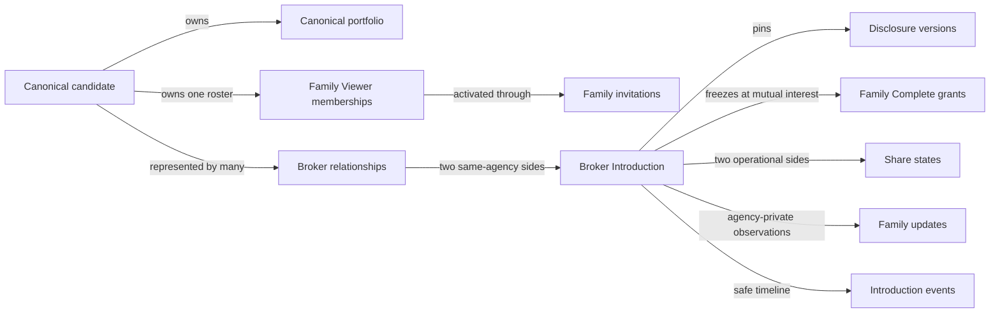
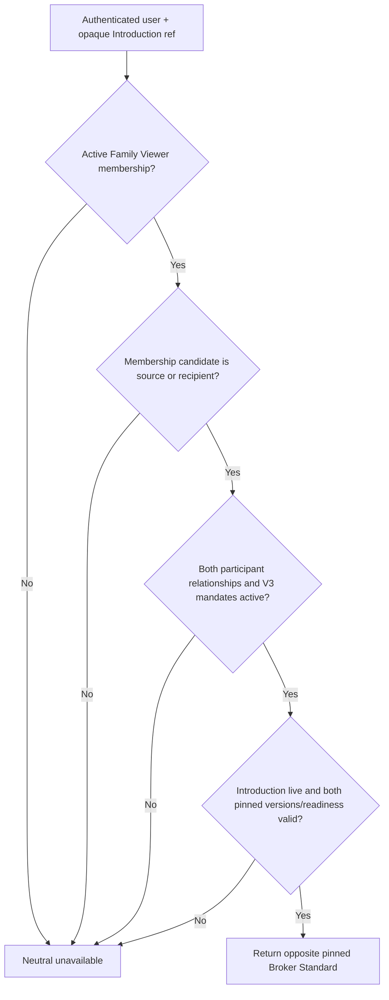
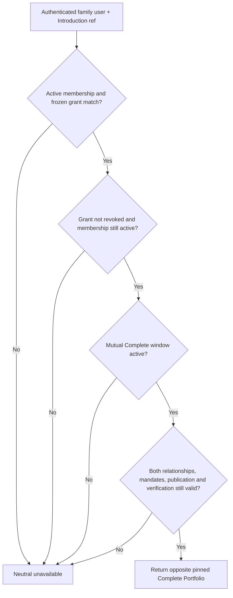

# VivIntroDesk family-assisted workflow: data architecture contract

Status: **proposed implementation design awaiting product review**, prepared on
20 October 2026. This document translates the authoritative
[`vivintrodesk-mvp-contract.md`](./vivintrodesk-mvp-contract.md) into a database,
RPC, endpoint, query, migration, and performance plan. It does not itself change
production schema or authorize a pilot.

## Purpose

Phase B must not begin with UI screens or loosely related tables. It begins with
one durable authorization model that preserves these product rules:

- the candidate owns one canonical portfolio and one candidate-level Family
  Viewer roster across all active brokers;
- a broker may propose a family member, but only the candidate may approve the
  proposal and only the intended Google account may activate it;
- a Family Viewer is read-only and never becomes the candidate's response
  authority in V1;
- Broker Standard access requires current V3 consent on both sides of that
  Introduction;
- Complete access is frozen at mutual interest, uses the already pinned
  disclosure versions, lasts 30 days, and excludes later-added viewers;
- removal revokes access immediately;
- broker share operations, private comments, and family reports remain
  agency-private; and
- no URL, request field, organization membership, or browser state may choose a
  candidate, viewer, participant side, or disclosure tier.

The design deliberately extends the existing `candidates`, `broker_clients`,
`broker_client_mandates`, `broker_introductions`, immutable disclosure versions,
audit events, command idempotency, and notification outbox. It does not create a
second candidate, portfolio, Introduction, or broker relationship domain.

## Existing foundation and gaps

| Existing object | Keep as source of truth | Gap to close |
| --- | --- | --- |
| `public.candidates` | Candidate identity and canonical owner | Add candidate-first query support through related indexes; do not add family data here |
| `public.broker_clients` | Agency-to-candidate relationship | Add a candidate-first index for cross-broker candidate/family queries |
| `app_private.broker_client_mandates` | Time-bound broker authority and capabilities | Store consent version structurally; do not parse `evidence_reference` |
| `app_private.broker_client_intakes` | Customer invitation and consent evidence | Permit new claims or explicit reconsent under V3 without upgrading old V2 rows |
| `app_private.portfolio_disclosure_versions` | Pinned Broker Standard and Complete data | Reuse the pinned projections; never copy profile JSON into family tables |
| `app_private.broker_introductions` | Bilateral pair, responses, mutual-interest window, pinned versions | Add family grants and side-specific operational state around it, not more participant columns |
| `app_private.broker_introduction_events` | Safe append-only Introduction timeline | Add safe event types; keep private comments out of `safe_details` |
| `app_private.brokerdesk_command_idempotency` | Idempotent broker commands | Reuse for all broker mutations |
| `app_private.notification_outbox` | Durable provider-neutral delivery jobs | Enqueue after committed state changes; notification success never grants access |

The existing overall `shared_at` flag cannot honestly represent two manual
WhatsApp handoffs. It may remain for compatibility, but new code must use one
side-specific share row per participant.

## Domain boundaries



Candidate-owned records are never tenant-owned merely because a broker proposed
them. Conversely, broker comments and reported updates do not become visible to
another agency merely because both agencies represent the same candidate.

## Planned database objects

All new tables live in `app_private`, have RLS enabled, and revoke direct access
from `public`, `anon`, and `authenticated`. Authenticated clients use narrowly
scoped `security definer` functions with `search_path = ''`; application routes
do not use a service-role client for ordinary user or broker authorization.
The closed `app_private.generate_public_reference` allowlist must be extended
only for `fvw`, `fvi`, and `fup`, with format and immutability tests for each.

### 1. Structured mandate consent version

Add `consent_version text` to `app_private.broker_client_mandates`.

Migration behavior:

1. Add the column nullable.
2. Backfill V1/V2 from the intake or existing evidence reference in a one-time,
   reviewed migration.
3. Abort the migration if any active mandate cannot be classified safely.
4. Add `NOT NULL` and a check limited to the supported versions.
5. Permit `broker-representation-v3` only after the V3 consent copy and command
   are deployed in the same release.

`evidence_reference` remains immutable audit evidence; it is not queried to make
an authorization decision. Existing V1/V2 mandates and already-issued Complete
access stay candidate-only. Renewal must not silently convert V2 to V3: the
candidate must accept the V3 terms through a dedicated reconsent command.

### 2. `candidate_family_viewers`

One row represents one candidate-to-family-account authorization lifecycle.

| Column | Type / rule | Purpose |
| --- | --- | --- |
| `id` | `uuid` primary key | Internal join key |
| `viewer_ref` | opaque `fvw_` reference, unique and immutable | Safe API identifier |
| `candidate_id` | FK `public.candidates(id)` | Candidate that owns this roster entry |
| `intended_email_hash` | normalized confirmed-email SHA-256 using the existing invitation convention | Exact audience binding without raw email |
| `intended_email_hint` | canonical lower-case masked email hint, or internal `Removed` tombstone | Candidate-facing recovery cue only; database rejects raw email |
| `verified_user_id` | nullable FK `auth.users(id)` | Independently authenticated family account |
| `display_name` | trimmed, 1–120 chars | Candidate/broker-entered familiar name |
| `relationship_kind` | controlled value | `father`, `mother`, `parent`, `sibling`, `guardian`, `relative`, or `other` |
| `relationship_label` | nullable, at most 40 chars | Required only when `relationship_kind = 'other'` |
| `preferred_locale` | nullable, bounded locale code | Future communication preference; not authorization |
| `role` | `viewer` or `primary` | Primary is operational, not extra authority |
| `status` | lifecycle value | `pending_candidate_approval`, `pending_verification`, `active`, `rejected`, or `revoked` |
| `proposed_by_organization_id` | nullable FK organization | Provenance of broker proposal, never roster ownership |
| `proposed_by_user_id` | nullable FK auth user | Broker actor provenance |
| `candidate_approved_by` | nullable FK auth user | Must be the current candidate owner at command time |
| `candidate_approved_at` | nullable timestamp | Approval evidence |
| `verified_at` | nullable timestamp | Exact-email Google account activation evidence |
| `revoked_at`, `revoked_by` | nullable timestamp/user | Immediate removal evidence |
| `row_version` | positive bigint | Optimistic concurrency |
| `created_at`, `updated_at` | timestamps | Ordering and operations |

State checks require:

- an active row has candidate approval, a verified user, and verification time;
- a pending-verification row has candidate approval but no verified user;
- a rejected row was never activated;
- a revoked row has `revoked_at` and cannot return to active;
- a primary row can be primary only while active; and
- broker organization provenance remains when only a proposal actor is later
  deleted; the personal broker actor reference is scrubbed. If sole-owner
  account deletion removes the organization itself, both provenance references
  are scrubbed before the restrictive organization foreign key is reached.

The database command, not the browser, also checks that `verified_user_id` is
not the candidate's current owner. Account deletion preparation revokes
dependent family authority, destroys pending tokens, removes verified/approval
user references and scrubs actor provenance before Auth deletion. It uses both
UUID links and the deleting account's normalized email hash, and also revokes
family rows attached to a surviving candidate owned by that account. The
identity FK remains restrictive so an active row can never silently survive
with a null identity.

No WhatsApp number is added to this table in V1. The number already belongs in
the candidate-owned Protected Contact/onboarding data and is used manually for
communication. Duplicating it here would create a second source of truth and an
unnecessary authentication temptation.

### 3. `candidate_family_viewer_invitations`

Invitations are retryable delivery capabilities, not memberships.

| Column | Type / rule | Purpose |
| --- | --- | --- |
| `id` | `uuid` primary key | Internal key |
| `invitation_ref` | opaque `fvi_` reference, unique | Safe invitation identifier |
| `family_viewer_id` | FK family viewer | Intended roster entry |
| `token_hash` | nullable unique SHA-256 | One-time secret; cleared after use |
| `intended_email_hash`, `intended_email_hint` | pinned while live; scrubbed on consumption/replacement/revocation | Prevents a live invitation retry from changing audience silently without retaining retired audience data |
| `invited_by` | nullable FK auth user | Candidate actor while live; scrubbed after consumption or account deletion |
| `expires_at` | creation time plus 7 days | Matches the current customer-invitation operating window |
| `accepted_by`, `accepted_at` | nullable user/time | Successful exact-email activation; actor may be scrubbed on account deletion while time remains |
| `revoked_at` | nullable timestamp | Invalidation |
| `created_at` | timestamp | Ordering |

Only a candidate-approved row may receive an invitation. A live invitation is
unique per family-viewer row. A replacement first revokes the previous token.
Acceptance requires a current Google-authenticated session with confirmed email
whose normalized hash equals the pinned hash. The RPC must confirm a current
`auth.identities` Google identity for that user; a confirmed email obtained only
through another provider is not silently treated as the approved V1 method. The
raw token is placed after the URL fragment, posted to an exchange endpoint,
never logged, and never returned after acceptance. There is no phone or manual
broker override path.

### 4. `broker_introduction_family_grants`

This table freezes the exact active family viewers that may receive Complete
access when mutual interest begins.

| Column | Type / rule | Purpose |
| --- | --- | --- |
| `id` | `uuid` primary key | Internal key |
| `introduction_id` | FK Introduction, cascade | Grant owner |
| `family_viewer_id` | FK Family Viewer, restrict | Frozen verified viewer |
| `participant_side` | `source` or `recipient` | Candidate represented by this viewer |
| `granted_at` | timestamp equal to mutual transition time | Freeze evidence |
| `revoked_at` | nullable timestamp | Immediate per-viewer revocation |
| `revocation_reason` | controlled nullable value | `viewer_removed`, `relationship_inactive`, `introduction_revoked`, `readiness_lost`, or `expired` |
| `created_at`, `updated_at` | timestamps | Operations |

The unique key is `(introduction_id, family_viewer_id)`. The grant does not copy
an expiry timestamp or portfolio payload: the Introduction's
`complete_access_expires_at` and pinned disclosure versions remain authoritative.
The transaction that creates grants validates that the membership's candidate
matches the chosen Introduction side. Reads revalidate that relationship rather
than trusting `participant_side` alone.

Later roster additions never create rows for an already-mutual Introduction.
Removing a viewer marks every active grant for that viewer revoked in the same
transaction. Expiry may be computed from the Introduction during reads and
materialized as a revocation event by an idempotent worker later.

### 5. `broker_introduction_share_states`

One row per `(introduction_id, participant_side)` records what the broker did,
not what WhatsApp delivered.

| Column | Type / rule | Purpose |
| --- | --- | --- |
| `introduction_id` | FK Introduction | Parent |
| `organization_id` | composite tenant integrity | Same organization as Introduction |
| `participant_side` | `source` or `recipient` | Target WhatsApp group |
| `share_state` | `not_started`, `initiated`, or `broker_confirmed` | Honest operational state |
| `initiated_at`, `initiated_by` | nullable timestamp/user | Share sheet or copy action started |
| `confirmed_at`, `confirmed_by` | nullable timestamp/user | Broker manually says shared |
| `last_reminded_at`, `last_reminded_by` | nullable timestamp/user | Last reminder action |
| `reminder_count` | non-negative integer | Bounded operational count |
| `row_version` | positive bigint | Concurrent updates |
| `created_at`, `updated_at` | timestamps | Operations |

Opening a native share sheet may transition only to `initiated`. There is no
`delivered` or `read` state without provider evidence. Both side rows are
created atomically with the Introduction so the action workspace never has to
infer missing state.

### 6. `broker_introduction_family_updates`

This append-only, tenant-private table stores what a broker heard from a family.
It is never merged into the candidate response columns.

| Column | Type / rule | Purpose |
| --- | --- | --- |
| `id` | `uuid` primary key | Internal key |
| `update_ref` | opaque `fup_` reference, unique | Safe command/result identifier |
| `organization_id` | tenant FK | Agency boundary |
| `introduction_id` | composite organization/Introduction FK | Introduction lineage |
| `participant_side` | `source` or `recipient` | Family being discussed |
| `reported_status` | controlled value | `interested`, `declined`, `needs_time`, `callback_requested`, `no_response`, or `other` |
| `channel` | controlled value | `whatsapp`, `phone`, `in_person`, or `other` |
| `family_viewer_id` | nullable FK | Used only when the reporting person is a known authorized viewer on that side |
| `internal_comment` | nullable, trimmed, at most 1,000 chars | Sensitive agency note; never sent or logged |
| `recorded_by` | FK auth user | Broker actor |
| `created_at` | timestamp | Immutable ordering |

Corrections append another update. The latest update is selected by
`created_at DESC, id DESC`; earlier records remain auditable. No free text is
placed in Introduction event JSON, analytics, notification payloads, or error
logs. Candidate confirmation continues through the existing authoritative
Introduction response command.

### Data minimization and cryptography

- Raw invitation tokens, OAuth tokens, and Google credentials are never stored;
  only one-way token hashes are persisted and are cleared after consumption.
- The existing normalized-email SHA-256 is an equality identifier, not
  encryption and not proof against offline email guessing. V1 may reuse it only
  inside private, access-revoked tables for consistency with current customer
  invitation matching. Any move to a keyed email digest must migrate customer
  and family invitation audiences together; two incompatible identity schemes
  are not acceptable.
- Raw WhatsApp numbers are not added to authorization tables. Phone remains
  communication data inside the candidate-owned protected model.
- Profile snapshots and Protected Contact are never copied into roster, grant,
  event, audit, notification, or share-state rows.
- Agency comments are optional, length-bounded, excluded from search indexes,
  and available only through the authorized broker projection. They rely on
  database/back-up encryption at rest and TLS in transit for V1. If a later
  threat model requires application-level envelope encryption, add it as one
  platform capability with rotation and recovery—not as per-feature crypto.
- Before pilot activation, verify hosted database, backup, log-retention, secret
  rotation, and point-in-time recovery settings; schema claims alone are not
  evidence that the operating environment is encrypted and recoverable.

## Required constraints and indexes

### Concurrency-safe invariants

PostgreSQL cannot enforce “at most three active rows” with a normal `CHECK`.
Every activation/replacement command must:

1. authenticate the candidate owner;
2. lock the `public.candidates` row `FOR UPDATE` (the stable roster lock);
3. count active roster entries;
4. reject activation when three already exist;
5. enforce candidate-not-self and exact-email identity; and
6. update membership, invitation, audit, and notification rows in one
   transaction.

The same candidate-row lock serializes primary changes. A partial unique index
provides a second line of defence:

```sql
create unique index candidate_family_viewers_one_primary_idx
  on app_private.candidate_family_viewers (candidate_id)
  where status = 'active' and role = 'primary' and revoked_at is null;
```

Required additional indexes:

| Object | Index | Query served |
| --- | --- | --- |
| Family viewers | unique `(candidate_id, intended_email_hash)` for pending/active rows | Duplicate invitation/proposal prevention |
| Family viewers | unique `(candidate_id, verified_user_id)` for active rows | Duplicate identity prevention |
| Family viewers | `(verified_user_id, candidate_id, created_at, id)` active partial | Family dashboard identity-to-candidate lookup |
| Family viewers | `(candidate_id, status, created_at, id)` | Candidate roster |
| Family viewers | `(proposed_by_organization_id, candidate_id, status, created_at DESC)` | Same-agency proposal status only |
| Family invitations | unique live `(family_viewer_id)` plus `(expires_at)` live partial | Replacement and expiry worker |
| Broker clients | `(candidate_id, organization_id, id)` | Cross-broker family dashboard without tenant scans |
| Introductions | `(broker_client_id, created_at DESC, id DESC)` identity-bound partial | Candidate/family source-side history across agencies |
| Introductions | `(recipient_broker_client_id, created_at DESC, id DESC)` identity-bound partial | Candidate/family recipient-side history across agencies |
| Frozen grants | `(family_viewer_id, introduction_id)` active partial | Family Complete authorization |
| Frozen grants | `(introduction_id, participant_side)` active partial | Opposite-family count and revocation |
| Share states | primary/unique `(introduction_id, participant_side)` | Action workspace |
| Share states | `(organization_id, share_state, updated_at, introduction_id)` pending partial | Broker work queue |
| Family updates | `(organization_id, introduction_id, participant_side, created_at DESC, id DESC)` | Latest update and timeline |

Do not add speculative indexes for every status. Validate these indexes using
real query plans, retain those serving named hot paths, and remove redundant
indexes that duplicate a unique constraint prefix.

### Query shape rules

- Use keyset pagination on `(created_at, id)`; never use unbounded reads or
  `OFFSET` for customer, family, Introduction, or timeline lists.
- Maximum server page size is 50; normal UI page size is 20–25.
- The candidate's actionable Family Viewer roster is a separate bounded set:
  at most 10 active/pending rows, at most five pending proposals from one
  agency, and at most three active viewers. A valid
  broker proposal always receives the same generic acknowledgement whether it
  created a row, duplicated an existing cross-agency audience, or reached the
  safe queue bound. The broker receives no viewer reference or membership
  result bit.
- Resolve source-side and recipient-side Introductions with two indexable
  branches joined by `UNION ALL`, not one large `OR` predicate.
- Filter authorization in SQL before returning JSON. Never load all agency rows
  and filter them in TypeScript.
- Batch safe counts and latest status in one projection; do not issue one query
  per customer, viewer, or Introduction.
- Use the immutable disclosure-version foreign keys already on the Introduction;
  no family query reads the candidate's current draft.
- Use `EXISTS` for authority checks and return a neutral unavailable result when
  any identity, consent, mandate, relationship, readiness, grant, or expiry
  predicate fails.

## RPC contract

All mutation RPCs require a current session, validate opaque reference formats,
authorize before returning an idempotent result, use bounded input, write an
audit event, and return safe JSON only. Broker mutations reuse
`brokerdesk_command_idempotency`. Candidate and family commands reuse the same
private table with `organization_id = null`; no second idempotency framework is
created. The table name is historical, but its actor/command/request-hash model
already supports these commands safely.

### Candidate and family commands

| RPC | Caller | Transactional responsibility |
| --- | --- | --- |
| `public.decide_family_viewer_proposal` | Candidate owner | Approve only when the candidate's re-entered email hashes to the pinned proposal audience, then create/replace the invitation; reject with no email/token material |
| `public.create_candidate_family_viewer` | Candidate owner | Direct candidate addition, roster lock, duplicate check, invitation creation |
| `public.accept_family_viewer_invitation` | Intended Google account | Exact-email match, one-time token consume, three-viewer lock, self-check, activation |
| `public.set_primary_family_viewer` | Candidate owner | Candidate lock, active-viewer validation, clear old primary and set new primary atomically |
| `public.revoke_family_viewer` | Candidate owner | Revoke membership, tokens, active frozen grants, sessions/caches, audit, and notifications atomically |
| `public.resolve_candidate_family_roster` | Candidate owner | Bounded roster, proposal, invitation, and access summary |
| `public.resolve_family_introductions` | Active Family Viewer | Cross-broker keyset page containing only safe labels and viewer-authorized state |
| `public.resolve_family_introduction` | Active Family Viewer | Revalidated Broker Standard or frozen Complete projection for the opposite side |

### Broker commands

| RPC | Capability | Transactional responsibility |
| --- | --- | --- |
| `public.propose_candidate_family_viewer` | new `family_viewers.propose` | Same-workspace active relationship, bounded fields and queue; generic acknowledgement only; never activates access or exposes cross-agency duplication |
| `public.resolve_brokerdesk_family_setup` | `customers.read` plus resource scope | Own-workspace proposal state and safe aggregate counts; never another broker's provenance |
| `public.record_introduction_share_action` | new `introductions.manage_sharing` | Side validation, optimistic version, honest state transition, audit event |
| `public.record_introduction_family_update` | new `introductions.record_family_update` | Same-tenant/side validation, append update, safe event, optional candidate notification |
| `public.resolve_brokerdesk_introduction_action` | `customers.read` and scoped Introduction access | Both share states, candidate responses, latest family reports, safe timeline, allowed actions |

Do not overload `introductions.record_response` for a family report. Its name is
too close to authoritative candidate consent. Add explicit capabilities and
apply this pilot matrix:

| Capability | Owner / admin | Advisor | Coordinator | Viewer |
| --- | --- | --- | --- | --- |
| `family_viewers.propose` | Organization | Assigned customers | Assigned customers | None |
| `introductions.manage_sharing` | Organization | Both assigned participants | Both assigned participants | None |
| `introductions.record_family_update` | Organization | Both assigned participants | Both assigned participants | None |

“Both assigned participants” prevents a staff member assigned to only one
family from learning the other family's private report or notes. The proposal
command never grants access, but its assignment scope still prevents broad
customer-data browsing.

### Existing RPCs to change carefully

- `claim_brokerdesk_customer_invitation`: invitations created after the V3
  release present and claim V3 terms. A still-live invitation created under V2
  remains claimable only as V2 during its original seven-day lifetime, giving
  candidate-only functionality; family access requires later explicit V3
  reconsent. Never rewrite a pending V2 invitation to V3.
- `manage_customer_broker_consent`: preserve the mandate's current consent
  version during ordinary renewal; renewal never broadens consent.
- `reconsent_customer_broker_relationship`: use a separate owner-only,
  idempotent V3 command that preserves the current term and never revives an
  Introduction.
- `create_identity_bound_broker_introduction`: require active V3 mandates on
  both sides if the Introduction will permit family Broker Standard access;
  create both share-state rows atomically.
- `respond_to_broker_introduction`: when the second confirmed Interested
  response starts mutual access, freeze each side's then-active viewers in the
  same transaction. Candidate response succeeds even if a side has zero family
  viewers.
- `resolve_broker_introduction`: preserve candidate behavior; extend the
  authorization branch for verified active family viewers without accepting a
  side, candidate, or disclosure-level parameter from the client.
- expiry and revocation functions: revoke or render unusable every applicable
  family grant and notification job idempotently.

## HTTP endpoint contract

Endpoints are thin adapters: same-origin checks for mutations, authenticated
session resolution, named rate limits, strict Zod bodies, bounded response
types, neutral errors, and calls to one repository/RPC boundary.

### Candidate and family

| Method and path | Purpose |
| --- | --- |
| `GET /api/v1/customer/family-viewers` | Candidate roster and pending proposals |
| `POST /api/v1/customer/family-viewers` | Candidate-direct invitation |
| `POST /api/v1/customer/family-viewers/[viewerRef]/decision` | Approve or reject broker proposal; approval requires candidate re-entry of the full email |
| `POST /api/v1/customer/family-viewers/[viewerRef]/primary` | Make one active viewer primary |
| `DELETE /api/v1/customer/family-viewers/[viewerRef]` | Immediate candidate revocation with expected version |
| `POST /api/v1/family-invitations/exchange` | Exchange fragment token for short-lived HttpOnly setup context |
| `POST /api/v1/family-invitations/accept` | Google-authenticated exact-email activation |
| `GET /api/v1/family/introductions` | Keyset-paginated read-only dashboard |
| `GET /api/v1/family/introductions/[introductionRef]` | Authorized opposite pinned projection |

The family dashboard has no response endpoint in V1. The existing
`POST /api/v1/introductions/[introductionRef]/response` remains candidate-only.

Broker proposals intentionally retain only a normalized email hash and masked
hint. On approval, the candidate re-enters the full email; the NAK-202 route
normalizes and hashes it, passes only the hash into the decision RPC, and sends
the invitation to the request-scoped address only after the database confirms
the exact hash. The raw address must never be stored in roster, invitation,
audit, idempotency, or notification metadata.
Closed, expired, and revoked Introductions may remain as safe history rows in
the dashboard, but their profile payload does not remain readable after the
applicable authorization window closes.

### Broker

| Method and path | Purpose |
| --- | --- |
| `POST /api/v1/brokerdesk/workspaces/[workspaceRef]/customers/[relationshipRef]/family-proposals` | Propose, but never authorize, a Family Viewer |
| `GET /api/v1/brokerdesk/workspaces/[workspaceRef]/customers/[relationshipRef]` | Extend current detail with own proposal status and safe roster count |
| `GET /api/v1/brokerdesk/workspaces/[workspaceRef]/introductions/[introductionRef]` | Introduction action workspace projection |
| `POST /api/v1/brokerdesk/workspaces/[workspaceRef]/introductions/[introductionRef]/share-actions` | Record side-specific initiated/confirmed/reminder action |
| `POST /api/v1/brokerdesk/workspaces/[workspaceRef]/introductions/[introductionRef]/family-updates` | Append a reported status and private comment |

The current `/shared` endpoint becomes a compatibility adapter during rollout
and is removed only after all UI callers use side-specific share actions. It
must not mark both sides shared from one click.

## Authorization decision paths

### Family Broker Standard read



### Family Complete read



Family Viewer count shown during the candidate's Interested confirmation is
computed from active eligible memberships for the opposite candidate. Names,
emails, phone numbers, proposal provenance, and agency-private comments are not
returned.

## Audit and notification events

Add named, stable events rather than arbitrary strings embedded in UI code:

- `family_viewer.proposed`
- `family_viewer.approved`
- `family_viewer.invitation_created`
- `family_viewer.activated`
- `family_viewer.primary_changed`
- `family_viewer.rejected`
- `family_viewer.revoked`
- `introduction.share_initiated`
- `introduction.share_confirmed`
- `introduction.reminder_initiated`
- `introduction.family_update_recorded`
- `introduction.family_grants_frozen`
- `introduction.family_grant_revoked`

Audit payloads contain opaque references, side, status, reason code, and actor
class only. They exclude raw email, phone, profile fields, comments, OAuth
tokens, invitation tokens, and Complete/Protected Contact payloads.

Notification jobs use deterministic deduplication keys derived from the domain
event and recipient identity. A failed send is retryable and observable; it
cannot roll back or manufacture consent. Manual WhatsApp actions are timeline
events, not notification-outbox delivery claims.

## Performance acceptance contract

Before UI rollout, seed two datasets:

- **pilot scale:** several workspaces, 100–1,000 relationships per workspace,
  realistic invitations, 0–3 viewers per candidate, and at least 10,000
  Introductions; and
- **growth scale:** multi-workspace data with skewed large agencies and at least
  1,000,000 Introductions so cross-agency viewer queries cannot pass by accident.

For each hot path capture `EXPLAIN (ANALYZE, BUFFERS, FORMAT JSON)` after
`ANALYZE`:

1. broker customer list and readiness filter;
2. eligible Introduction recipient list;
3. candidate family roster;
4. broker customer family setup;
5. family dashboard across several brokers;
6. single family Introduction authorization and disclosure resolution;
7. broker Introduction action workspace and timeline;
8. expiry/revocation worker batches; and
9. notification outbox claim batches.

Acceptance requires:

- no sequential scan of a large tenant, Introduction, grant, or membership
  table on an interactive path;
- stable keyset pagination with bounded returned and removed rows;
- no N+1 repository pattern;
- no sort or hash spill for normal page sizes;
- index conditions that include the viewer/candidate or tenant boundary before
  status/expiry filtering;
- worker queries using `FOR UPDATE SKIP LOCKED`, deterministic batch limits, and
  retry-safe state transitions; and
- recorded plan evidence in the feature document and CI artifact.

Do not commit arbitrary millisecond targets before the hosted database tier and
network baseline exist. Establish p50/p95 budgets in staging, then make them
release gates. Logical bounds and query-plan correctness are mandatory now.

## Migration and rollout sequence before Phase B UI

1. **Schema inventory test.** Encode the current V2 mandate, Introduction,
   response, pinning, expiry, revocation, and notification behavior as pgTAP
   regression tests.
2. **Consent/RBAC migration.** Add structured mandate consent version, V3 terms,
   explicit family/share/update capabilities, and safe backfill assertions.
3. **Family identity migration.** Add roster and invitation tables, reference
   generation, constraints, indexes, private grants, candidate commands, and
   race tests.
4. **Read projections.** Add candidate roster and family dashboard resolvers
   with keyset pagination and cross-tenant negative tests.
5. **Introduction operations migration.** Add side share-state rows, family
   updates, action projection, new capabilities, and compatibility handling for
   the old overall shared state.
6. **Disclosure migration.** Extend the existing resolver and response
   transaction for V3 Broker Standard reads and frozen mutual-interest grants.
7. **Revocation/worker migration.** Cover viewer removal, broker relationship
   end, mandate loss, unpublish, liveness expiry, Introduction revoke, Complete
   expiry, and retry recovery.
8. **Performance gate.** Run both fixture sizes, retain plan artifacts, and tune
   only from evidence.
9. **Wireframe-to-endpoint review.** Confirm every button maps to one permitted
   command and every visible state maps to one server projection before coding
   production screens.

## VivIntroDesk 200-series delivery map

All new broker-product engineering work uses the NAK-200 series. The NAK number
is the repository-owned engineering work-item identifier and appears in the
feature record, branch, commit, and pull-request title. GitHub assigns its own
unrelated numeric pull-request number. Linear is not part of this workflow.

| Work item | Purpose | Expected branch |
| --- | --- | --- |
| NAK-200 | Structured V3 broker consent and explicit family/share/update RBAC capabilities | `feat/nak-200-v3-consent-rbac-foundation` |
| NAK-201 | Candidate-owned Family Viewer roster, Google-email invitations, constraints, RPCs, and race tests | `feat/nak-201-family-viewer-identity-foundation` |
| NAK-202 | Assisted customer onboarding readiness, email status, WhatsApp handoff, and family proposal UI | `feat/nak-202-assisted-customer-onboarding` |
| NAK-203 | Read-only Family Viewer dashboard and cross-broker bounded projections | `feat/nak-203-family-introduction-dashboard` |
| NAK-204 | Introduction action workspace with side-specific share state, reminders, and timeline | `feat/nak-204-introduction-action-workspace` |
| NAK-205 | Agency-private family updates and candidate-confirmation prompts | `feat/nak-205-family-update-confirmation` |
| NAK-206 | V3 Family Viewer Broker Standard access and frozen mutual-interest Complete grants | `feat/nak-206-family-disclosure-grants` |
| NAK-207 | Revocation workers, security tests, query-plan evidence, recovery drills, and bounded pilot gate | `security/nak-207-brokerdesk-pilot-hardening` |

Do not combine these automatically. A work item may be split if migration or
review evidence shows that it exceeds one independently verifiable security
boundary. Do not move later UI work ahead of the authority and projection on
which it depends.

Each migration is forward-only, separately named, and deployable with old
application code where practical. No migration backfills V3 consent, active
family authority, or historical Complete grants. Rollback hides new UI and
revokes new entry points; it never broadens old records or reconstructs secrets.

## Mandatory database and API tests

- roster activation race cannot create a fourth active viewer;
- two simultaneous primary changes leave exactly one primary;
- candidate self-addition, duplicate email, and duplicate user are rejected;
- wrong-email, unconfirmed-email, expired, replayed, and replaced invitations
  fail neutrally;
- broker proposal cannot activate a viewer or reveal another broker's proposal;
- candidate approval with an email that does not hash to the broker's proposal
  fails neutrally and creates no invitation;
- public commands and table constraints reject an unmasked email in every
  family hint field;
- the actionable roster cannot exceed 10 rows and a full/duplicate proposal
  remains indistinguishable to the broker;
- account-deletion preparation revokes Family Viewer authority, clears pending
  secrets (including address-only pending invitations), revokes family rows on
  surviving owned candidates, and removes every new Auth and sole-owner
  organization foreign-key blocker;
- V1/V2 mandates never authorize family reads;
- ordinary renewal never becomes V3 reconsent;
- family user cannot respond, close, revoke, comment, or mutate an Introduction;
- unrelated family user and modified references reveal no participant oracle;
- later-added viewer cannot inherit an old frozen Complete grant;
- removed viewer loses Broker Standard and Complete access immediately;
- candidate response remains authoritative when a family update conflicts;
- share initiated never appears as delivered or read;
- one agency cannot read another agency's comments, reports, share state, or
  Introduction lineage;
- pinned Broker Standard/Complete remains unchanged after portfolio edits;
- every readiness, mandate, relationship, revocation, and expiry failure closes
  access; and
- idempotent retries produce one logical mutation, audit event, and notification
  intent.

## Decisions intentionally deferred

- WhatsApp OTP or phone-only identity;
- AiSensy automation or delivery receipts;
- family response delegation;
- personal paid-family entitlement;
- per-broker family rosters;
- cross-broker coordination;
- changing historical frozen grants when the roster changes;
- searchable/full-text broker comments; and
- a generic workflow or task engine.

These are extensions, not empty fields to add “for future use.” They require a
new contract and migration when evidence justifies them.

## Phase B entry gate

Phase B implementation may start only after review confirms:

1. the six planned objects and their ownership boundaries;
2. structured V3 consent instead of evidence-string parsing;
3. candidate-row locking for the three-viewer limit;
4. exact-email Google activation and no V1 phone authorization;
5. explicit new RBAC capabilities;
6. side-specific share state and append-only family updates;
7. frozen grants only at mutual interest;
8. the endpoint/RPC boundary and compatibility plan; and
9. the named query-plan and security test evidence.

After approval, the first implementation slice should be the consent/RBAC and
family identity foundation only. It should not include UI, family disclosure,
or broker action-workspace behavior in the same pull request.
